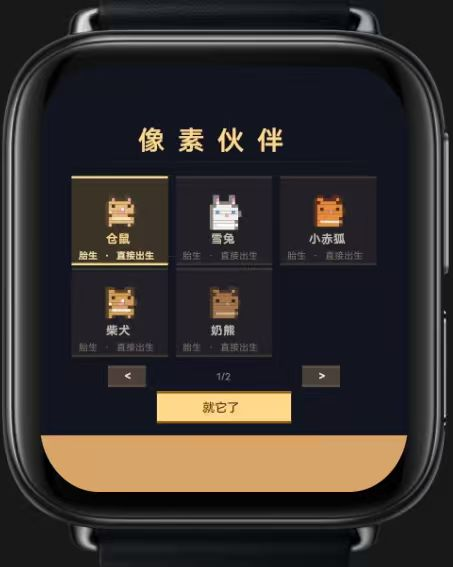
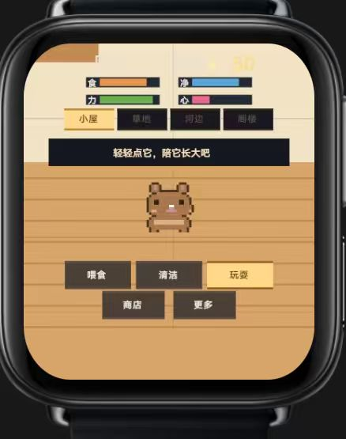
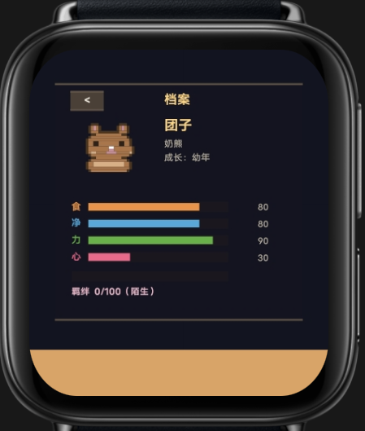
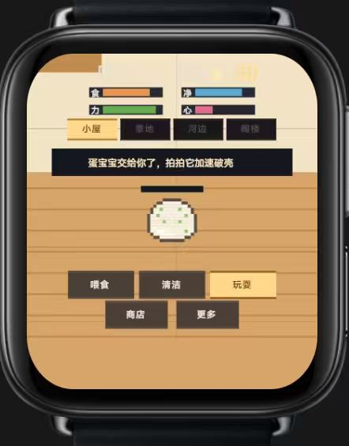

# 像素伙伴 Pixel Pet 🐹⌚

一款为 vivo BlueOS 智能手表设计的像素宠物养成游戏。选一位小伙伴，照料它的日常、陪它玩耍，看它在你的陪伴下慢慢长大。

## 游戏截图

| 选择伙伴 | 日常陪伴 | 成长档案 | 卵生伙伴 |
| --- | --- | --- | --- |
|  |  |  |  |

## 玩法特色

- **十种像素伙伴**：从仓鼠、雪兔、小赤狐、柴犬、奶熊，到龟吉利、企鹅、鸭鸭、小章鱼和团团龙。不同伙伴有各自的外形与个性。
- **两种出生方式**：胎生伙伴会直接来到你身边；卵生伙伴从蛋开始，等待破壳。
- **日常照料与互动**：喂食、清洁、玩耍，照看饥饿、清洁、精力和心情，并逐渐培养彼此的羁绊。
- **陪伴式成长**：伙伴会经历不同成长阶段，养育和探索习惯会影响成年后的形态；满足条件时还有机会遇见稀有闪光个体。
- **布置自己的小屋**：收集家具和装扮，摆放房间；伙伴也会与家具互动。
- **小游戏、签到和商店**：通过小游戏与每日签到获得奖励，再为伙伴添置食物、玩具、家具和装扮。
- **图鉴与故事**：记录伙伴的成长、动作和事件，逐步解锁新的场景与故事内容。
- **离线时间也会结算**：离开游戏后，重新打开时会根据经过的时间更新伙伴状态和成长。

## 下载与安装

下载本仓库中的 RPK 文件，并在支持 vivo BlueOS 快应用的手机或手表环境中安装：

[下载像素伙伴 RPK](com.sci.pixelpet.debug.production.1.0.0.rpk)

- 应用包名：`com.sci.pixelpet`
- 版本：`1.0.0`（versionCode `43`）
- 适配形态：圆屏与方屏手表
- 包类型：调试签名 RPK
- 首次解锁需要联网验证购买后获得的 12 位数字卡密。

---

戴上手表，常回来看看它。🐾
